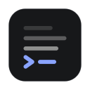
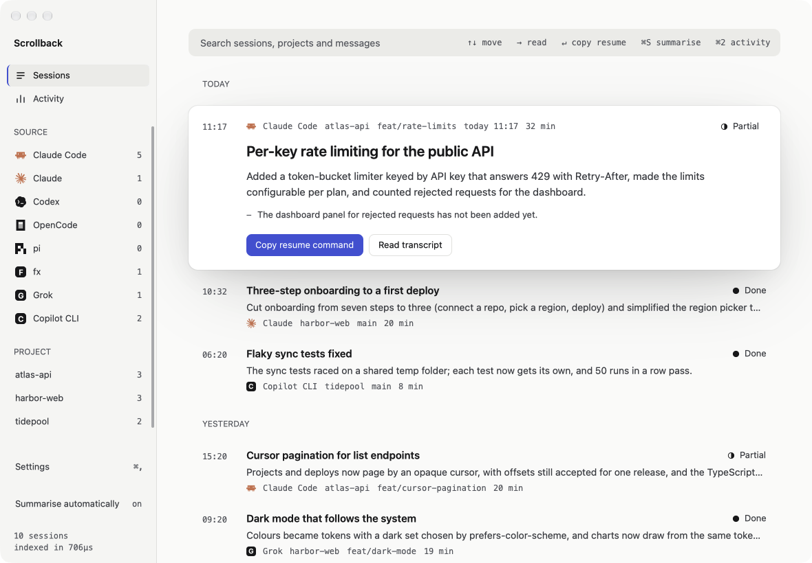
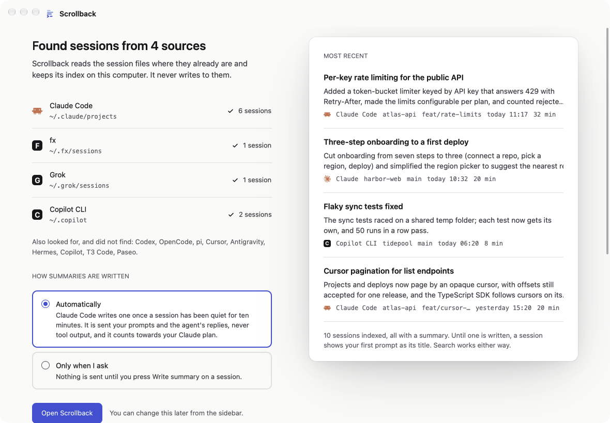
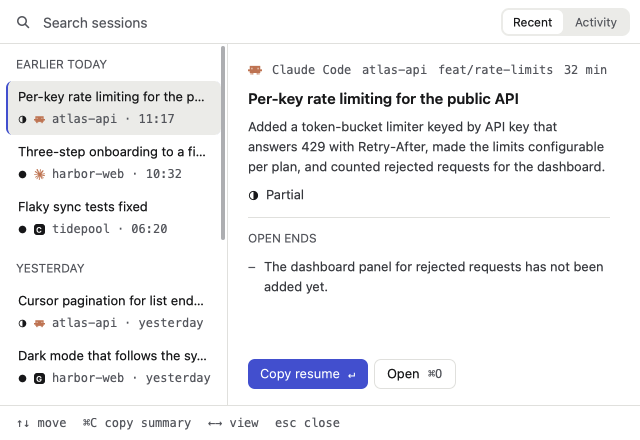
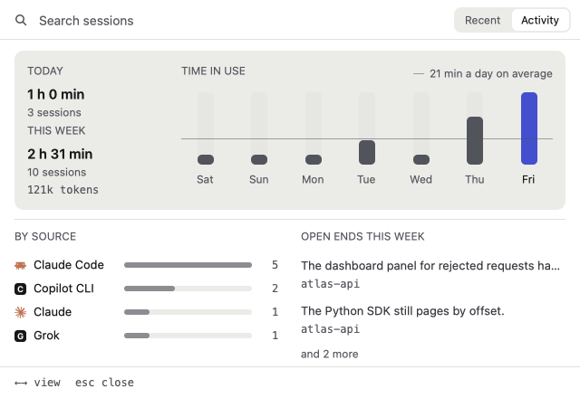

# Scrollback

Your coding-agent sessions in one place, each with a short summary of what
happened and what was left open, written by Claude Haiku through the Claude
Code command line you already use, or by a model of your choosing.

Scrollback reads the session history your coding agents already keep
(Claude Code, Codex, OpenCode, Cursor, GitHub Copilot, Grok and more),
indexes it, and writes a summary beside each session,
so you can find last Tuesday's work by what it was about instead of
scrolling through transcripts.

<picture>
  <source media="(prefers-color-scheme: dark)" srcset="docs/screenshots/sessions-dark.png">
  
</picture>

## Features

- **A small, fast native app.** Built in Rust with [GPUI](https://www.gpui.rs).
  It opens with your sessions already on screen and stays out of the way in
  the menu bar.
- **Fast search.** Type anywhere in the window to search titles, projects,
  summaries and every message in every session, with results as you type.
- **Summaries by default.** Once a session goes quiet, Scrollback writes a
  title, a short summary, how it ended and anything left to pick up. Sessions
  you are still working in are summarised as you go. Claude Haiku writes them
  unless you choose Ollama or another service.
- **Transcripts grouped by step.** Open a session to read it as the steps the
  summary describes, each folding open to the turns behind it.
- **One-step resume.** Copy the command that reopens a session in the tool it
  came from.
- **Find and export.** Find text inside a session (⌘F), or save it as
  Markdown (⇧⌘E, or `scrollback export`).
- **Open at login.** Start in the menu bar when you log in.
- **Activity.** Your week at a glance: time in use each day, which tools you
  used, and the open ends still waiting.
- **Menu bar popover.** Recent summaries and the week's activity, a click
  away, without opening the window.
- **Read-only and local.** Scrollback never writes to your tools' files, and
  its index stays on your computer.

## Screenshots

### First run

Scrollback shows which tools it found sessions for, and asks whether
summaries should be written automatically.

<picture>
  <source media="(prefers-color-scheme: dark)" srcset="docs/screenshots/intro-dark.png">
  
</picture>

### Menu bar

A click on the menu bar icon opens recent summaries, or the week at a glance.

<table>
  <tr>
    <th>Recent</th>
    <th>Activity</th>
  </tr>
  <tr>
    <td>
<picture>
  <source media="(prefers-color-scheme: dark)" srcset="docs/screenshots/popover-recent-dark.png">
  
</picture>
    </td>
    <td>
<picture>
  <source media="(prefers-color-scheme: dark)" srcset="docs/screenshots/popover-activity-dark.png">
  
</picture>
    </td>
  </tr>
</table>

## Sources

| Source | Read from |
| --- | --- |
| Claude Code, and the Claude app's coding sessions | `~/.claude/projects` |
| Codex, and the ChatGPT app's Codex sessions | `~/.codex` |
| OpenCode | `~/.local/share/opencode` |
| pi | `~/.pi/agent/sessions` |
| Cursor | Cursor's own data folder |
| fx | `~/.fx/sessions` |
| Grok Build | `~/.grok/sessions` |
| Hermes Agent | `~/.hermes` (`%LOCALAPPDATA%\hermes` on Windows) |
| GitHub Copilot CLI | `~/.copilot/session-state` |
| GitHub Copilot in VS Code | VS Code's user folder, `chatSessions` |
| T3 Code, Paseo | label the sessions they started in the tools above |

Each folder can be changed in Settings → Sources, and any source can be
hidden there. Folders also follow each tool's own setting where it has one,
such as `CLAUDE_CONFIG_DIR`, `CODEX_HOME`, `FX_HOME`, `GROK_HOME`,
`HERMES_HOME` or `COPILOT_HOME`.

## Install

Download the latest release from the
[Releases page](https://github.com/frankievalentine/Scrollback/releases/latest):

| System | Download | Then |
| --- | --- | --- |
| macOS (Apple silicon and Intel) | `scrollback-<version>-macos.zip` | Unzip and move Scrollback to Applications |
| Linux (Debian, Ubuntu) | `scrollback_<version>_amd64.deb` | `sudo apt install ./scrollback_*.deb` |
| Linux (other) | `scrollback-<version>-linux-x86_64.tar.gz` | Unpack and run `./install.sh` |
| Windows | `scrollback-<version>-windows-x64-setup.exe` | Run the installer; no administrator rights needed |

**First launch on macOS.** Scrollback is not yet signed with an Apple Developer
ID, so macOS asks before opening it the first time. Open it once from
Applications by Control-clicking it and choosing Open, or run:

```sh
xattr -dr com.apple.quarantine /Applications/Scrollback.app
```

**First launch on Windows.** SmartScreen may warn about an unrecognised app;
choose More info, then Run anyway.

## Summaries

Choose who writes them in Settings → Summaries:

| Provider | What you need | Where requests go |
| --- | --- | --- |
| **Claude** (default) | [Claude Code](https://claude.com/claude-code) installed and signed in | Through Claude Code, counted towards your Claude plan. Haiku 5.5 or Haiku 4.5. |
| **Ollama** | [Ollama](https://ollama.com) running, with a model pulled | Nowhere: the model runs on your computer |
| **OpenAI** | An OpenAI API key | OpenAI. GPT-6 Luna by default. |
| **OpenCode Go** | An OpenCode Go API key | OpenCode |
| **Vercel AI Gateway** | A Vercel AI Gateway key | Vercel, then the model's provider |
| **Cloudflare AI Gateway** | A Cloudflare API token and account id | Cloudflare, then the model's provider |
| **Other** | Any service with an OpenAI-compatible chat API | Wherever you point it |

API keys are kept in your system's keychain (Keychain on macOS, Credential
Manager on Windows, the Secret Service on Linux), never in Scrollback's
settings. A key already set in `OPENAI_API_KEY` or `AI_GATEWAY_API_KEY` is
picked up without pasting it.

Whichever provider you choose, what is sent for each session is the same:
your prompts, the agent's replies, and the names and targets of the tools it
used. Tool output and file contents are never sent. Without a provider set
up, everything else works and sessions show their first prompt instead.
Automatic summaries can be turned off in Settings → General.

Smaller local models write rougher summaries than Haiku, and sometimes miss
where each step began; the summary is still kept when they do.

## Where things are kept

| | macOS | Linux | Windows |
| --- | --- | --- | --- |
| Index and settings | `~/Library/Application Support/Scrollback` | `~/.local/share/scrollback` | `%LOCALAPPDATA%\Scrollback` |

The Linux folder is lower case, like the other tools in `~/.local/share`. A
folder left from an older version under a different spelling is renamed the
first time Scrollback starts.

Deleting that folder resets Scrollback; it rebuilds the index on its next
start and writes the summaries again.

## Command line

The same index is available from a terminal:

```sh
scrollback list                  # recent sessions
scrollback search token refresh  # fuzzy search
scrollback show runyard redesign # a session's summary
scrollback summarize -n 10       # summarise the ten newest without one
scrollback export runyard -o runyard.md  # a session as Markdown
scrollback --help                # everything else
```

On a Mac the command is built at `target/release/scrollback`; the Linux
packages install it on your path.

## Building from source

You need [Rust](https://rustup.rs) (stable) and, on a Mac, the Xcode command
line tools (`xcode-select --install`).

### macOS

```sh
git clone https://github.com/frankievalentine/Scrollback.git scrollback
cd scrollback
scripts/bundle.sh --install
```

This builds `Scrollback.app`, installs it in `/Applications` and signs it for
this Mac. Open it from Launchpad or Spotlight.

### Linux

Install the libraries GPUI builds against (Debian and Ubuntu shown):

```sh
sudo apt install pkg-config cmake clang libxkbcommon-dev libxkbcommon-x11-dev \
  libwayland-dev libx11-xcb-dev libxcb1-dev libfontconfig-dev libfreetype-dev \
  libssl-dev libzstd-dev libvulkan-dev libasound2-dev
```

Then build a package and install it:

```sh
scripts/package-linux.sh
sudo apt install ./target/package/scrollback_*.deb
```

Or unpack `target/package/scrollback-*.tar.gz` and run `./install.sh` to
install into `~/.local` without root.

### Windows

```powershell
pwsh scripts/package-windows.ps1
```

This leaves a zip in `target\package`, and an installer too if
[Inno Setup](https://jrsoftware.org/isinfo.php) is installed.

Linux and Windows builds are newer than the Mac one and have had less use.

## Development

```sh
cargo run --release -p scrollback-app   # the app
cargo test                              # the tests
scripts/check-platforms.sh              # Linux tests and a Windows build, in Docker
scripts/linux-preview.sh                # a picture of the app running on Linux
```

The code is in three crates: `crates/core` reads the sources, keeps the index
and writes summaries; `crates/app` is the GPUI app; `crates/cli` is the
command line.

## License

MIT. See [LICENSE](LICENSE).
